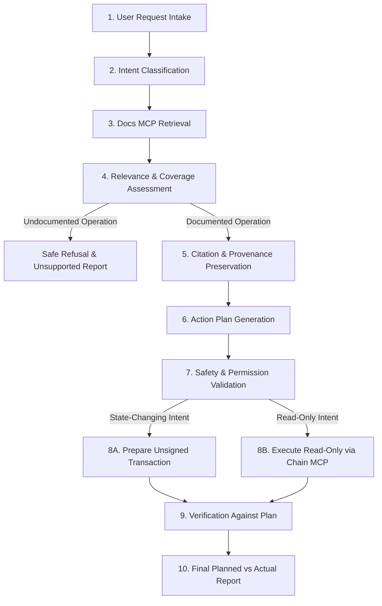

# ARCHITECTURE — DOC-GROUNDED BUILDER AGENT

## 1. System Overview

The **Pharos Doc-Grounded Builder Agent** is an autonomous, evidence-driven builder system designed to answer "How do I do X on Pharos?" questions. Rather than relying on generic AI training data or improvising undocumented contract calls, the agent enforces a strict, verifiable 10-stage execution pipeline.



---

## 2. The 10-Stage Execution Pipeline

### Stage 1: User Request Intake
- Accepts natural-language questions such as:
  - "How do I query live block timestamp and chain ID from MultiCall3 on Pharos?"
  - "How do I check the native PROS balance and transaction count of an address on Pharos?"
  - "How do I prepare a native PROS transfer on Pharos Pacific Mainnet?"
  - "How do I stake with Lido liquid staking on Pharos?" (Negative test)
- Validates parameters (e.g., target address, value) when provided, or uses documented defaults.

### Stage 2: Intent Classification
- Evaluates the query into one of the canonical categories:
  - `CANONICAL_CONTRACT_QUERY`: Querying verified contracts (MultiCall3, Permit2, EntryPoint, etc.).
  - `ACCOUNT_STATE_INSPECTION`: Querying native account balances, nonces, or token status.
  - `TRANSACTION_PREPARATION`: Preparing unsigned transactions with calldata, gas estimation, and nonces.
  - `UNDOCUMENTED_OR_UNKNOWN`: Queries with no established documentation coverage.

### Stage 3: Official Developer Docs MCP Retrieval
- Communicates directly with the official Docs MCP endpoint (`https://docs.pharos.xyz/~gitbook/mcp`).
- Executes `searchDocumentation(query)` to find authoritative sections and canonical URLs.
- Executes `getPage(url)` if comprehensive context or specific contract addresses/ABIs are required.

### Stage 4: Documentation Relevance & Coverage Assessment
- Evaluates whether the retrieved documentation actually covers the requested operation.
- **Fail-Safe Gate:** If the documentation does not contain instructions or addresses for the requested feature (e.g. Lido staking, flash loans on unsupported DEXes), execution stops immediately. The agent halts with status `UNSUPPORTED`, records what was queried, and explains what is missing. It never invents a procedure.

### Stage 5: Source Citation & Evidence Preservation
- Captures full provenance:
  - Document Title (e.g. "Canonical Contracts", "Network", "Pharos Skill Engine")
  - Canonical URL (e.g. `https://docs.pharos.xyz/getting-started/canonical-contracts`)
  - Relevant documented excerpt
  - Exact documented parameters (e.g. contract address `0xcA11bde05977b3631167028862bE2a173976CA11`, Chain ID `1672`).

### Stage 6: Action Plan Generation
- Formulates a sequential, structured execution plan **prior to taking any chain action**:
  - `steps`: Ordered list of concrete steps with expected inputs/outputs.
  - `targetTools`: Exact MCP tools to be invoked (`eth_call`, `get_balance`, `estimate_gas`, etc.).
  - `expectedOutcomes`: Quantified expectations (e.g. expected chain ID = 1672, non-zero timestamp, valid balance string).

### Stage 7: Plan Safety and Capability Validation
- Classifies each step as:
  - `READ_ONLY`: Safe to query live via Chain MCP.
  - `STATE_CHANGING`: Restricted to unsigned transaction preparation only.
- Strict Invariants enforced:
  - Zero private keys or mnemonics requested or processed.
  - Zero transaction signing.
  - Zero transaction broadcasting.
  - Halts state-changing workflows at unsigned transaction review.

### Stage 8: Chain MCP / SkillEngine Execution
- Connects to official Chain MCP endpoint (`https://mcp.pharos.xyz/mcp`) via SSE JSON-RPC 2.0.
- For `READ_ONLY`:
  - Dispatches `eth_call`, `get_chain_info`, `get_balance`, or `get_transaction_count`.
  - Captures raw RPC response and decodes data with verified ABI definitions.
- For `STATE_CHANGING`:
  - Dispatches `estimate_gas`, `get_gas_price`, and `get_transaction_count` (nonce).
  - Prepares the complete unsigned transaction payload (`to`, `value`, `data`, `gasLimit`, `maxFeePerGas`, `nonce`, `chainId`).
  - Sets transaction status to `AWAITING_USER_SIGNATURE`.

### Stage 9: Independent Outcome Verification
- Directly verifies returned data against the expectations recorded in Stage 6:
  - For contract reads: verifies decoded value is valid, conforms to ABI specification, and matches network status.
  - For account checks: verifies balance format and address validity.
  - For unsigned transactions: verifies calldata formatting, chain ID match (1672), and gas estimate reasonableness.

### Stage 10: Final Planned vs. Actual Report
- Generates a comprehensive evidence report:
  - Original user request
  - Document citations and links
  - Structured plan
  - Steps executed
  - Planned vs. Actual comparison table
  - Final verdict status: `VERIFIED`, `AWAITING_USER_SIGNATURE`, or `UNSUPPORTED`.

---

## 3. Directory and Component Structure

```
pharos-doc-grounded-builder-agent/
├── api/                             # Bundled serverless functions for Vercel
│   ├── ask.js                       # POST /api/ask (Doc-Grounded Builder Agent workflow)
│   ├── health.js                    # GET /api/health (Chain MCP & Docs MCP health check)
│   └── docs.js                      # GET /api/docs (Documentation search and inspection)
├── docs/                            # Evidence reports and engineering specifications
│   ├── ARCHITECTURE.md
│   ├── DEPLOYMENT_REPORT.md
│   ├── DOCUMENTATION_PROVENANCE.md
│   ├── EXECUTION_AND_VERIFICATION.md
│   ├── FINAL_REQUIREMENTS_MATRIX.md
│   ├── OFFICIAL_TASK_AUDIT.md
│   ├── PHASE1_OFFICIAL_AUDIT.md
│   ├── TEST_REPORT.md
│   ├── UNSUPPORTED_REQUEST_TEST.md
│   └── WORKFLOW_EVIDENCE.md
├── public/                          # Client-side presentation layer
│   ├── app.js                       # Interactive controller & state renderer
│   ├── index.html                   # Polished evidence dashboard
│   └── styles.css                   # Responsive layout & status styling
├── src/
│   ├── api/                         # TypeScript source for serverless endpoints
│   │   ├── ask.ts
│   │   ├── docs.ts
│   │   └── health.ts
│   ├── core/                        # Core agent logic
│   │   ├── chain-client.ts          # Chain MCP SSE JSON-RPC 2.0 client
│   │   ├── docs-client.ts           # Docs MCP SSE JSON-RPC 2.0 client
│   │   ├── intent.ts                # Intent classification & query parsing
│   │   ├── planner.ts               # Action plan generator
│   │   ├── verifier.ts              # Outcome verification engine
│   │   └── agent.ts                 # Full 10-stage agent orchestrator
│   ├── types/                       # Shared type definitions
│   │   └── index.ts
│   └── build.ts                     # Build script using esbuild
├── tests/                           # Automated test suite
│   ├── unit/                        # Unit tests (intent, planner, verifier, safety)
│   └── integration/                 # Live integration tests (Docs MCP & Chain MCP)
├── .gitignore
├── LICENSE
├── package.json
├── README.md
├── tsconfig.json
└── vercel.json
```
